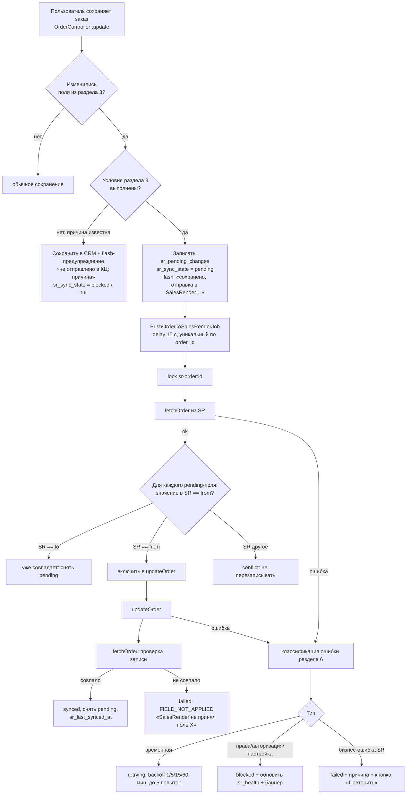

# Отправка изменений заказа в SalesRender (`updateOrder`)

**Дата:** 21.11.2026  
**Статус:** реализовано (этапы 0–1), см. раздел 14. Не развёрнуто на боевом аккаунте: проверки O1–O10 не выполнены  
**Контекст:** сейчас интеграция односторонняя для данных: CRM создаёт лид (`addOrder`) и дальше только читает (`ordersFetcher`). Правки в нашей CRM в уже отправленную заявку SalesRender не попадают.

## Цель

1. Изменения, сделанные в CRM по заказу, у которого есть `orders.external_id`, отправляются в SalesRender через `orderMutation.updateOrder`.
2. Это **не скрытое фоновое действие**: пользователь всегда видит, дошло ли изменение, а если нет — почему и что сделать.
3. Если у токена нет нужных прав, пользователь получает готовый текст запроса для колл-центра (КЦ).
4. Отправка не конфликтует с существующей синхронизацией `SyncSalesRenderJob` (SalesRender → CRM) и не теряет правки операторов КЦ.

---

## 1. Что проверено на живом SalesRender (пробный аккаунт, 21.11.2026)

Endpoint тот же, что в `SalesRenderService`: `https://de.backend.salesrender.com/companies/{id}/CRM`, заголовок `Authorization: <token>`.

| Факт | Результат |
|------|-----------|
| Мутация существует | `orderMutation.updateOrder(input: UpdateOrderInput!)` |
| Поля `UpdateOrderInput` | `id!`, `statusId`, `orderData`, `cart`, `reminder`, `callingScript`, `logistic`, `customerId`, `exception`, `timezoneOffset`, `lastCallAttempt`, `targetId` |
| `cart` | `CartInput { items: [CartItemInput], promotions }`; `CartItemInput { itemId!, variation!, quantity, pricing }` — тот же формат, что в `addOrder` |
| `orderData` | типизированные списки: `phoneFields`, `humanNameFields`, `addressFields`, `stringFields`, `booleanFields`, `enumFields` и др.; каждый элемент `{ field: "<id поля>", value }` |
| `AddressInput` | `postcode, region, city, address_1, address_2, building, apartment, countryCode, location, additional_1..3` |
| Успешный `updateOrder` | телефон заказа изменён и подтверждён повторным `ordersFetcher` |
| **Неизвестный id поля** | `updateOrder` вернул **успех**, но данные **не записались** (поле `name` отсутствует в новом аккаунте). SalesRender молча игнорирует несуществующий `field` |
| Невалидный токен | HTTP **401**, `errors[0].message = "Invalid token"`, `extensions.code = 401` |
| Неверный Company ID | HTTP **404**, `extensions.code = "COMPANY_NOT_FOUND"` |
| **Токен без прав роли** | HTTP **200** (!), `data.orderMutation.updateOrder = null`, `errors[0].extensions = { category: "ROLE", code: "FIELD_RESTRICTED_BY_ROLE", restriction: { type: "OrderMutation", field: "updateOrder" } }`. Для чтения — то же самое с `type: "Query", field: "ordersFetcher"` |
| Роли в SalesRender | у токена обязательна роль; роль `Director` для токена **не допускается** (`The role "Director" cannot be used`); права задаются *ограничениями* поверх родительской роли («Restrictions on order editing», «Restrictions on order adding» и др.); есть IP-whitelist на роль и срок действия токена |
| Скрытие поля телефона | в роли есть ограничение «Hide fields with the "Phone" type in orders» — токен с ним видит заказ без телефона |

**Не проверено (проверить на боевом аккаунте до релиза, см. раздел 12):** семантика замены корзины и адреса (полная замена или merge), единицы `pricing.unitPrice` (в `addOrder` цена передаётся в копейках `×100`, а `fetchOrder` сохраняет `unitPrice` как есть), поведение `updateOrder` для заказа в финальном статусе, ответ на несуществующий `id`, ответ при IP вне whitelist.

---

## 2. Текущая реализация и найденные конфликты

Файлы: [`SalesRenderService.php`](../../app/Services/SalesRenderService.php), [`SyncSalesRenderJob.php`](../../app/Jobs/SyncSalesRenderJob.php), [`WebhookController.php`](../../app/Http/Controllers/WebhookController.php), [`OrderController.php`](../../app/Http/Controllers/OrderController.php), [`OrderObserver.php`](../../app/Observers/OrderObserver.php), [`HandleInertiaRequests.php`](../../app/Http/Middleware/HandleInertiaRequests.php), [`AppLayout.vue`](../../resources/js/Layouts/AppLayout.vue).

| № | Конфликт / риск | Где | Что делать |
|---|-----------------|-----|------------|
| C1 | **Потерянное обновление (pull затирает локальную правку).** `SyncSalesRenderJob` каждые 5 минут для заказов «Позвонить» читает SR и, пока статус не финальный, **перезаписывает** `goods/quantities/prices/variations` и `comment/upsell` данными из SR. Если пользователь изменил корзину, а push ещё не ушёл (или упал), следующий прогон вернёт старое | `applyNonFinalUpdates()` | Хранить `sr_pending_changes` (раздел 4); pull пропускает поля с неотправленной правкой |
| C2 | **Финальный статус затирает всё.** `applyConfirmedData()` для «Принят» безусловно перезаписывает ФИО, адрес и корзину. Правка, не доехавшая до SR, исчезнет без следа | `applyConfirmedData()` | Поля с pending-правкой не перезаписываются, заказ получает `sr_sync_state = conflict`, пользователь уведомляется |
| C3 | **Observer сработает на правки самого sync-job.** `OrderObserver::updated` вызывается при любом `update()`: из `SyncSalesRenderJob`, webhook, CSV-импорта, трекинга. Если повесить push на observer — получим петлю «SR → CRM → SR» и отправку чужих правок | `OrderObserver` | Push **не** на observer. Явный вызов `SrPushService::schedule()` из `OrderController::update()` / `updateStatus()` (раздел 5) |
| C4 | **`validate()` сломается после смены телефона.** Sync сравнивает последние 9 цифр телефона заказа и SR. Если телефон изменён локально, а в SR не ушёл, финальный статус даст «VALIDATION» и заказ навсегда останется «Позвонить» | `SyncSalesRenderJob::validate()` | Пока `phone` в `sr_pending_changes`, сравнивать SR-телефон с `from` (значением до правки), а не с текущим |
| C5 | **Баннер единственный и затирается.** `storeFailures()` пишет в `sr_last_sync_failures` весь список при каждом прогоне (даже пустой). Ошибки push там не сохранятся; баннер закрываем (`sr_sync_failures_seen_at`) и он пропадает, хотя проблема осталась | `storeFailures()`, `shareSrSyncFailures()` | Отдельное постоянное состояние (раздел 4, 8), не использовать этот слот |
| C6 | **Уже есть тихие отказы без уведомления.** `post()` возвращает ответ при HTTP 200 и не смотрит на `errors`. Токен без прав на чтение: `fetchOrder()` → «заказ не найден» → `skipped++`, в баннер **не попадает**. Токен без права `addOrder`: webhook создаёт заказ без `external_id`, лид не уходит в КЦ, пользователь не знает | `SalesRenderService::post()`, `WebhookController` | Разбирать `errors[]` во всех операциях, писать health-состояние интеграции (раздел 7). Исправляется **в той же задаче**, иначе новая фича унаследует проблему |
| C7 | **Статусы: соответствие сейчас только входящее и не симметричное.** Pull отображает «Принят»→«Заказать» и **все** «Отменен/Отмена/Дубли/Спам»→«Отказ(Ошибка)»; «Дубли» не даёт «Дубль» (с `funnel_exclude`), «Спам» не даёт «Спам». Обратного соответствия нет. Статусы SR настраиваются в каждом аккаунте, в `updateOrder` нужен `statusId`, а не имя | `SR_FINAL_STATUSES`, `applyRefusal()`, `Order::STATUSES` | Утверждено соответствие в обе стороны (раздел 3.1), входящая часть меняется; отправка статуса входит в этап 1 |
| C8 | **Адрес в CRM — потерявший структуру.** Pull склеивает `city = "region city zip"`; `street=address_1`. Обратное преобразование невозможно без порчи `region/city/postcode` в SR | `applyConfirmedData()` | Адрес не входит в MVP (фаза 2, после выбора схемы, раздел 10) |
| C9 | **Комментарий берётся из `stringFields[0]`, допродажа из `booleanFields[0].field.label`.** Это порядок полей, а не привязка к конкретному полю | `extractSrNoteFields()` | Отправка комментария — только после явной настройки соответствия полей (фаза 2) |
| C10 | **ФИО.** `sendOrder` кладёт всё ФИО в `lastName`; pull склеивает `firstName + lastName`. Оператор КЦ может разделить имя на части — сравнение должно идти по нормализованной строке, а не по частям | `addOrder`, `applyConfirmedData()` | Сравнение по нормализованному «имя фамилия» (trim, схлопывание пробелов, регистр) |
| C11 | **Корзина — это замена целиком.** Если в SR оператор добавил допродажу, а CRM отправит свою (устаревшую) корзину, позиция оператора будет удалена | cart | Перед push — чтение SR и сверка (раздел 5, шаг 4); при расхождении — `conflict`, без перезаписи |
| C12 | **Привязка товара.** Для корзины нужны `itemId` (`products.sr_item_id`) и номер вариации; если у товара нет `sr_item_id`, отправить корзину нельзя | `Product.sr_item_id`, `ProductVariationService` | Понятная ошибка «товар X не связан с позицией SalesRender» |
| C13 | **Встроенный колл-центр.** Для магазинов с внутренним КЦ (`storeHasInternalCallCenter`) заказы в SR не уходят, `external_id` пуст | `WebhookController` | Push не планируется (нет `external_id`). Оператор внутреннего КЦ (`isCallCenter()`) не должен получать SR-уведомления |
| C14 | **Read-only тенант** (подписка истекла) | `$tenant->isReadOnly()` | Push не планируется, как в `WebhookController`; показывать «режим только чтения» |
| C15 | **Гонки двух задач.** `withoutOverlapping()` защищает только планировщик; push-job и sync-job работают параллельно над одним заказом | Kernel, jobs | Блокировка на заказ `Cache::lock('sr-order:{id}', 60)` в обеих задачах |
| C16 | **Нагрузка на каждый запрос.** `shareSrSyncFailures()` делает несколько `TenantSetting::get` (расшифровка) на каждый Inertia-запрос | `HandleInertiaRequests` | Новое состояние читать одной выборкой (кэш на 60 с, сброс при записи) |
| C17 | **Версия PHP.** В документации PHP 7.4 / Laravel 8, в коде уже встречается синтаксис PHP 8 (`catch (X)` без переменной, `?->`) | — | Перед реализацией проверить реальную версию; не использовать enum/readonly/match, если 7.4 |

Вне scope: Google Sheets / GAS (`backend/SalesRender.gs`) — отдельная кодовая база.

---

## 3. Что отправляем и в каком направлении

| Поле CRM | Поле SR | MVP | Примечание |
|----------|---------|-----|------------|
| `phone` | `orderData.phoneFields[field="phone"]` | да | формат `PhoneNormalizer::toInternationalDigits`; ключ идентификации, см. C4 |
| `full_name` | `orderData.humanNameFields[field="name"]` | да | значение в `lastName` (как в `addOrder`), C10 |
| `goods/quantities/prices/variations` | `cart.items` | да | замена целиком; C11, C12; **цены: единицы проверить**, раздел 12 |
| `city/street/building/apartment` | `orderData.addressFields` | фаза 2 | C8 |
| `comment/upsell` | `stringFields/booleanFields` | фаза 2 | C9 |
| `status` | `statusId` | да, только статусы с парой (3.1) | C7; `statusId` берётся из `statusesFetcher` по имени |
| `track_number`, `delivery_type`, `callback_at` и пр. | — | нет | в SR не хранятся |

### 3.1. Соответствие статусов (утверждено)

| CRM | SalesRender | Направление |
|-----|-------------|-------------|
| Заказать | Принят | ⇄ |
| Отказ(Ошибка) | Отменен | ⇄ |
| Дубль | Дубли | ⇄ |
| Спам | Спам | ⇄ |
| Отказ(Ошибка) | Отмена | только входящее (SR → CRM) |

Остальные статусы CRM («Перезвонить», «Недозвон…», «Сомнения», «Отказ», «Отдал заявку», всё после «Подтвержден») пары не имеют: в SalesRender **не отправляются**, и пользователь видит это явно («Статус «X» в SalesRender не передаётся», уровень 1–2 из раздела 8), а не тихий пропуск.

Изменения во входящей части (`SyncSalesRenderJob`):

- «Дубли» → **«Дубль»** (а не «Отказ(Ошибка)»); при этом применяются те же побочные эффекты, что при ручной смене статуса (`funnelFieldsForStatusChange`: `funnel_exclude = true`), а склад/доход обрабатывает `OrderObserver` как обычно;
- «Спам» → **«Спам»**;
- «Принят» → «Заказать», «Отменен»/«Отмена» → «Отказ(Ошибка)» (без изменений);
- `applyRefusal()` получает статус из таблицы соответствия, а не константу.

Правила отправки статуса:

1. Соответствие хранится в настройке `sr_status_map` (раздел 4.3), по умолчанию заполнено таблицей выше; `statusId` подставляется по имени из `statusesFetcher` при проверке подключения. Если имени нет в SalesRender (аккаунт настроен иначе) — пара помечается «не найден в SalesRender», статус не отправляется, ошибка `STATUS_NOT_FOUND_IN_SR`.
2. Отправка статуса — отдельная пара в том же `updateOrder` (одним запросом с данными), `sr_pending_changes.status = {from, to}`.
3. **Защита от петли:** следующий прогон pull видит SR-статус, равный `to`, снимает pending и **не применяет** `applyConfirmedData()` повторно, если CRM уже в соответствующем статусе; иначе данные (ФИО, адрес, корзина) из SR перезапишут локальные.
4. Конфликт статуса: если SR-статус ≠ `from` и ≠ `to` (оператор КЦ уже перевёл заказ в другой статус), статус не перезаписывается → `conflict`, как для данных.
5. Массовая смена (`bulkUpdateStatus`) тоже планирует отправку по каждому заказу; результат в ответе JSON дополняется `sr_push: {queued, skipped, not_mapped}`, а в интерфейсе показывается сводка.
6. Статус в CRM меняется всегда (CRM остаётся рабочим инструментом магазина); отказ SalesRender не откатывает локальный статус, но заказ получает `failed/blocked/conflict` (раздел 5).

Id полей (`name`, `phone`) берутся из настроек, а не зашиваются: см. настройку `sr_field_map` в разделе 4. Из-за «тихого игнорирования неизвестного поля» (раздел 1) id **проверяются** через `orderFieldsFetcher` при проверке подключения, а результат push **подтверждается чтением** (раздел 5).

Условия, при которых изменение вообще планируется к отправке:

1. `sr_push_enabled = 1` (новая настройка, **по умолчанию выключена** — существующие магазины не меняют поведение без явного включения);
2. `sr_enabled = 1`, заполнены `api_token_call_centr`, `company_id_in_call_centre`;
3. у заказа есть `external_id`;
4. тенант не read-only; пользователь — не оператор внутреннего КЦ;
5. статус заказа из `Order::preShipmentStatuses()` (после отправки посылки данные в SR заморожены); список вынести в константу.

---

## 4. Модель данных

### 4.1. Таблица `orders` (новая миграция `2026_11_2x_..._add_sr_push_columns_to_orders_table.php`)

| Колонка | Тип | Назначение |
|---------|-----|------------|
| `sr_sync_state` | string(16) nullable, index | `null` — не применимо; `synced`, `pending`, `retrying`, `failed`, `blocked`, `conflict` |
| `sr_pending_changes` | json nullable | `{ "phone": { "from": "375…", "to": "375…", "at": "ISO", "user_id": 5 }, "cart": {…}, "full_name": {…} }`. `from` фиксируется **один раз** (значение до первой неотправленной правки), `to` обновляется |
| `sr_last_error_code` | string(40) nullable | код из таксономии раздела 6 |
| `sr_last_error_message` | string(500) nullable | человекочитаемая причина (без токена, без сырых ответов SR) |
| `sr_last_attempt_at` | timestamp nullable | |
| `sr_last_synced_at` | timestamp nullable | время последней успешной отправки/подтверждения |
| `sr_push_attempts` | unsigned tinyint default 0 | |

Добавить в `Order::$fillable` / `$casts` (`sr_pending_changes` → `array`). Модель `Order` из `CALL_CENTER_EDITABLE_FIELDS` не затрагивается.

### 4.2. Таблица `order_sr_pushes` (журнал попыток, хранение 30 дней)

`id, tenant_id, order_id, user_id nullable, fields json, status (success|failed|skipped|conflict), error_code, http_status, message, duration_ms, created_at`. Для разбора обращений в поддержку и истории в карточке заказа. Очистка — команда в `Kernel` раз в сутки.

### 4.3. Настройки тенанта (`tenant_settings`, значения шифруются)

| Ключ | Значение |
|------|----------|
| `sr_push_enabled` | `'1'` / пусто |
| `sr_health` | JSON: `{ state, code, message, details, since, last_checked_at, notified_at }`; `state ∈ ok, permission_denied, auth_failed, config_error, unreachable, unknown` |
| `sr_field_map` | JSON: `{ phone_field_id, name_field_id, … }` (по умолчанию `phone`, `name`) |
| `sr_status_map` | JSON: `{ "Заказать": {"sr_name":"Принят","sr_id":null}, "Отказ(Ошибка)": {"sr_name":"Отменен"}, "Дубль": {"sr_name":"Дубли"}, "Спам": {"sr_name":"Спам"} }`; `sr_id` заполняется проверкой подключения; плюс список входящих синонимов (`Отмена` → «Отказ(Ошибка)»); редактируется в настройках |
| `sr_cc_contact` | свободный текст/ссылка (Telegram, email КЦ) для кнопки «Запросить права»; опционально |

Не использовать `sr_last_sync_failures` (C5). Все чтения `sr_*` для шаринга в Inertia — одним запросом/кэшем (C16).

---

## 5. Поток отправки



Принципы:

1. **Job берёт актуальное состояние заказа на момент выполнения**, а не payload из запроса. Несколько правок за 15 секунд превращаются в одну отправку (дебаунс через `ShouldBeUnique` + задержку).
2. **Правка всегда сохраняется в CRM**, даже если отправка заблокирована. CRM остаётся источником правды для оператора магазина, SR — для КЦ; расхождения не скрываются, а помечаются (`blocked`/`conflict`).
3. **Трёхсторонняя сверка по `from/to`** вместо снимка всего заказа: если в SR значение ≠ `from` и ≠ `to`, значит КЦ изменил его независимо → `conflict` (C11). Для заказов, созданных до внедрения, ничего догонять не нужно: `from` фиксируется в момент правки.
4. **Подтверждение чтением** после `updateOrder` (из-за тихого игнорирования неизвестных полей и неопределённой семантики замены).
5. Pull (`SyncSalesRenderJob`) дорабатывается так: поля из `sr_pending_changes` не перезаписываются (C1); если значение в SR совпало с `to` — pending снимается; для финального статуса — C2/C4; `storeFailures` остаётся для pull-ошибок, но не используется для push.
6. Обе задачи берут `Cache::lock('sr-order:{id}')` (C15); при занятом замке push откладывается (`release(30)`).
7. Для вызова с веба нельзя блокироваться на 30 секунд (текущий таймаут `post()`): синхронно делается только проверка условий и запись pending, сама отправка — в очереди (`QUEUE_CONNECTION=database`, worker уже обслуживает `SyncSalesRenderJob`).

### Конфликт: политика

| Ситуация | Результат |
|----------|-----------|
| локально изменено, в SR не менялось | отправляем |
| в SR изменено КЦ, локально не менялось | pull забирает (как сейчас) |
| изменено и там, и там | `conflict`: ничего не перезаписываем, пользователь выбирает «Оставить моё (отправить)» или «Принять из SalesRender» |
| SR перешёл в «Принят» при наличии pending | статус и непересекающиеся данные берутся из SR; поля с pending остаются локальными, `conflict` |
| SR вернул «не найден» для `external_id` | `failed: ORDER_NOT_FOUND`, подсказка «заявка удалена в SalesRender или ID неверный» |

---

## 6. Таксономия ошибок и сообщения пользователю

Единый класс результата в `SalesRenderService`: `SrResult { ok, data, errorCode, httpStatus, message, restriction, retryable }`. Ответы разбираются по `HTTP-статус → errors[].extensions.{category,code}`; текст SR никогда не показывается пользователю «как есть» без обрезки до 200 символов, токен не логируется.

| Код (`sr_last_error_code`) | Признак | Повтор | Состояние | Что видит пользователь |
|----------------------------|---------|--------|-----------|------------------------|
| `PERMISSION_DENIED` | HTTP 200, `extensions.code = FIELD_RESTRICTED_BY_ROLE`, `restriction.{type,field}` | нет | `blocked`, `sr_health = permission_denied` | «У токена SalesRender нет права **изменять заказы** (`updateOrder`). Изменение сохранено в CRM, но колл-центр его не видит.» + кнопка «Запросить права у колл-центра» (раздел 7) |
| `PERMISSION_DENIED_READ` | то же, `Query.ordersFetcher` | нет | `blocked` | «У токена нет права **читать заказы**. Статусы из колл-центра не обновляются и изменения нельзя сверить.» |
| `PERMISSION_DENIED_CREATE` | то же, `addOrder` | нет | заказ без `external_id` | «Заявка не отправлена в колл-центр: у токена нет права **создавать заказы**» (исправление C6) |
| `PHONE_HIDDEN` | заказ получен без `phoneFields` при непустом `external_id` (роль скрывает телефон) | нет | `blocked` | «Роль токена скрывает телефон клиента: сверка заказа невозможна. Нужна роль без ограничения «Hide phone fields».» (**гипотеза, подтвердить**) |
| `AUTH_INVALID` | HTTP 401 «Invalid token» | нет | `blocked`, `auth_failed` | «Токен SalesRender недействителен или истёк. Укажите новый токен в настройках.» |
| `AUTH_FORBIDDEN_IP` | HTTP 403 / ошибка whitelist | нет | `blocked` | «SalesRender не принимает запросы с адреса нашего сервера (IP-ограничение роли). Передайте колл-центру IP: {ip}.» (**формат ответа проверить**) |
| `CONFIG_COMPANY` | HTTP 404 `COMPANY_NOT_FOUND` | нет | `blocked`, `config_error` | «Неверный Company ID в настройках SalesRender.» |
| `CONFIG_INCOMPLETE` | пусты токен/company/project | нет | не планируем | «Интеграция SalesRender включена, но не заполнены настройки: …» |
| `ORDER_NOT_FOUND` | пустой `ordersFetcher` / ошибка id | нет | `failed` | «Заявка не найдена в SalesRender (удалена или ID неверный).» |
| `FIELD_NOT_APPLIED` | чтение после `updateOrder` не показало изменение | нет | `failed` | «SalesRender принял запрос, но не изменил поле «{поле}». Проверьте, что в проекте SalesRender есть такое поле заказа.» |
| `CART_ITEM_UNMAPPED` | у товара нет `sr_item_id` / вариации | нет | `failed` | «Товар «{название}» не связан с позицией SalesRender. Укажите ID позиции в карточке товара.» |
| `SR_REJECTED` | прочие GraphQL-ошибки (валидаторы заказов, триггеры SR) | нет | `failed` | «SalesRender отклонил изменение: {первые 200 символов}» |
| `STATUS_UNMAPPED` | у статуса CRM нет пары (3.1) | нет | заказ не блокируется, `sr_sync_state` не меняется | «Статус «{X}» в SalesRender не передаётся — в колл-центре заявка остаётся в прежнем статусе» (информационное, в flash и в карточке) |
| `STATUS_NOT_FOUND_IN_SR` | имя статуса из `sr_status_map` отсутствует в `statusesFetcher` | нет | `failed`, предупреждение в настройках | «В SalesRender нет статуса «{имя}». Проверьте соответствие статусов в настройках интеграции.» |
| `CONFLICT` | расхождение по правилам раздела 5 | нет | `conflict` | «Заявку изменили в SalesRender. Ваши изменения: … Значение в SalesRender: … Что оставить?» |
| `TRANSIENT` | таймаут, HTTP 5xx/429, сетевая ошибка | да (1/5/15/60 мин, 5 попыток) | `retrying`; после лимита `failed` | в карточке: «Повторная отправка через N мин (попытка k из 5)»; после лимита — как `failed` с кнопкой «Повторить» |
| `LOCAL_READONLY` | тенант read-only | нет | не планируем | «Режим только чтения — изменения не отправляются.» |

Правило: **у каждого нерабочего состояния есть текст «что произошло» и «что сделать»**. Состояния без действия для пользователя (`unknown`) запрещены: неклассифицированная ошибка идёт в `SR_REJECTED` с обрезанным текстом SR и пишется в `Log::warning` с `order_id`, `tenant_id`.

---

## 7. Состояние интеграции (health) и запрос прав у колл-центра

### 7.1. Health

`SalesRenderService` при любой операции (`sendOrder`, `fetchOrder`, `updateOrder`, проверка подключения) сообщает результат в `SrHealthService`:

- ошибки классов `PERMISSION_*`, `AUTH_*`, `CONFIG_*`, `PHONE_HIDDEN` → `sr_health.state` меняется, фиксируется `since`, список недостающих операций накапливается в `details.missing` (`OrderMutation.updateOrder`, `Query.ordersFetcher`, `OrderMutation.addOrder`);
- успешная операция снимает соответствующий пункт; пустой `missing` → `state = ok`;
- при переходе `ok → не ok` выставляется флаг на уведомление (раздел 8).

Это закрывает C6: для **любой** SR-операции (включая существующие) отсутствие прав становится видимым.

### 7.2. «Проверить подключение» (Настройки → SalesRender)

Кнопка выполняет безопасные пробы **без изменения реальных данных**:

1. `ordersFetcher` с пустым фильтром (`ids: []`) — право на чтение;
2. `orderFieldsFetcher` — наличие полей `sr_field_map` (иначе предупреждение «поле «name» не найдено — имя отправляться не будет»);
3. `updateOrder` с заведомо несуществующим `id` — по факту наблюдения, ограничение роли срабатывает **до** обращения к данным (`data.updateOrder = null`, `FIELD_RESTRICTED_BY_ROLE`), поэтому ответ «заказ не найден» означает, что право есть, а `FIELD_RESTRICTED_BY_ROLE` — что права нет (**зафиксировать фактический ответ на боевом аккаунте**);
4. право на `addOrder` проверяется только по факту реального лида (не создаём тестовые заказы в боевом проекте).

Результат — таблица «Чтение заказов ✓ / Изменение заказов ✗ / Создание заказов — не проверено / Поля name, phone ✓». Включить `sr_push_enabled` разрешается только если проба 3 пройдена (иначе тумблер недоступен с пояснением).

### 7.3. «Запросить права у колл-центра»

Кнопка в баннере и в настройках показывает модальное окно с готовым текстом и кнопками «Скопировать», «Открыть в Telegram/почте» (если задан `sr_cc_contact`). Текст формируется по `sr_health.details.missing`:

```
Здравствуйте! Нашей CRM нужен API-токен SalesRender с расширенными правами.
Компания (Company ID): {company_id}
Проект: {project_id}

Сейчас у токена нет прав на:
 • изменение заказов — orderMutation.updateOrder
 • чтение заказов — ordersFetcher
Ошибка SalesRender: FIELD_RESTRICTED_BY_ROLE

Что нужно сделать: создайте токен с ролью, у которой НЕ включены ограничения
«Restrictions on order editing» (редактирование заказов) и «Orders → Viewing restrictions»,
и не скрыты поля типа «Phone». Если у роли задан список разрешённых IP —
добавьте адрес нашего сервера: {server_ip}.
Новый токен пришлите нам — укажем его в настройках интеграции.
```

Токен в сообщении не фигурирует. Текст не содержит данных клиентов и ФИО пользователя. `{server_ip}` берётся из конфигурации (`config('services.salesrender.outbound_ip')`, задаётся на деплое) — если не задан, строка опускается.

### 7.4. Автовосстановление

Когда токен сохранён заново или проверка подключения пройдена: `sr_health = ok`, заказы `blocked` ставятся в очередь повторно **через ту же сверку по `from/to`** (раздел 5), поэтому накопившиеся за дни правки не затрут более новые данные КЦ. Перед массовой повторной отправкой — подтверждение «Отправить N накопленных изменений в SalesRender?».

---

## 8. Оповещения пользователю (чтобы не было «тихих» отказов)

| Уровень | Где | Когда | Поведение |
|---------|-----|-------|-----------|
| 1. Сразу после сохранения | flash в `AppLayout.vue` (`flash.message` / `flash.error`) | каждое сохранение заказа с SR-полями | «Заказ обновлён. Отправляем изменения в SalesRender…» / предупреждение «Сохранено в CRM, но **не отправлено** в колл-центр: {причина}» (если блокировка известна заранее по `sr_health`) |
| 2. Карточка заказа | `Orders/Show.vue` | всегда, если есть `external_id` | бейдж: ✓ «В SalesRender (дата)», ⏳ «Отправляется», ⟳ «Повтор через N мин», ⚠ «Не отправлено: {причина} [Повторить]», 🔒 «Нет прав у токена [Что делать]», ⚡ «Конфликт [Сравнить и выбрать]»; список последних попыток из `order_sr_pushes` |
| 3. Список заказов | `Orders/Index.vue` | есть заказы с `sr_sync_state ∈ failed, blocked, conflict` | счётчик и фильтр «Не отправлено в колл-центр (N)»; маркер в строке |
| 4. Баннер на всех страницах | `AppLayout.vue` (новый, рядом с существующим баннером sync) | `sr_health.state != ok` или есть `conflict` | **не закрывается**, пока проблема актуальна (для `permission_denied/auth_failed/config_error`); закрывается на сутки для `unreachable`. Кнопки «Запросить права у колл-центра», «Настройки», «Проверить подключение» |
| 5. Настройки | `Settings/Index.vue`, блок SalesRender | всегда | индикатор «Подключено / Нет прав: изменение заказов / Токен недействителен», время последней проверки, кнопки из раздела 7 |
| 6. Email владельцу | `Mail/` (по образцу `SubscriptionEndingMail`) | при первом переходе `ok → не ok` и не чаще раза в 24 ч; плюс строка в `DailyDigestMail` при наличии `failed/blocked/conflict` | фаза 2, но порядок важен: пользователь может неделю не открывать CRM |

Видимость: баннер и кнопки «Запросить права / Проверить» — владельцу/админу тенанта (кто имеет доступ к `Settings`, см. `SettingsAccessTest`); бейджи в заказах — всем, кто видит заказ. Оператор внутреннего КЦ SR-элементов не видит (C13).

Endpoint-ы: `POST /api/orders/{order}/sr-push/retry`, `POST /api/orders/{order}/sr-push/resolve` (`keep_local | accept_sr`), `POST /settings/salesrender/check`, `POST /settings/salesrender/retry-blocked`. Все — через `authorize()` и `TenantScope`; повтор по чужому заказу невозможен.

---

## 9. Безопасность и надёжность

- Токен хранится как сейчас (шифруется `TenantSetting`), не пишется в логи, не попадает в `order_sr_pushes`, в баннер, в письма и в текст запроса к КЦ.
- Тексты ошибок SR обрезаются (200 символов) и экранируются на фронте (Vue, без `v-html`).
- Идемпотентность: повторный `updateOrder` с теми же значениями безопасен (значения абсолютные, не дельты).
- Нет автоматического «forced overwrite»: перезапись конфликта только явным действием пользователя `keep_local`, оно журналируется (`order_sr_pushes`, `user_id`).
- Лимит исходящих запросов: один push на заказ не чаще раза в 15 с (дебаунс), массовое «Повторить» — пачками по 20 с паузой.
- Переключатель `sr_push_enabled` — быстрое выключение в случае проблем в проде; при выключении pending-правки не теряются (`sr_pending_changes` сохраняется).

---

## 10. План реализации

**Этап 0. Предпосылки (без изменения поведения для пользователей)**

- [ ] `SalesRenderService`: заменить `post()` на `SrResult`, разбирать `errors[]` по HTTP 200; `sendOrder()/fetchOrder()` сохраняют прежние возвращаемые значения, но пишут результат в `SrHealthService` (закрывает C6)
- [ ] `SrHealthService` + настройки `sr_health`; расширение `shareSrSyncFailures()` с кэшем (C16)
- [ ] Баннер health в `AppLayout.vue`, блок статуса и кнопка «Проверить подключение» в `Settings/Index.vue`, «Запросить права у колл-центра» (разделы 7.2–7.3)

**Этап 1. MVP отправки: телефон, ФИО, корзина**

- [ ] Миграции: колонки `orders` (4.1), таблица `order_sr_pushes` (4.2)
- [ ] `SalesRenderService::updateOrder()`; `SrPushService::schedule()`; `PushOrderToSalesRenderJob` (unique, lock, backoff, подтверждение чтением)
- [ ] Вызов из `OrderController::update()` (не из observer, C3); flash-сообщения уровня 1
- [ ] Доработка `SyncSalesRenderJob`: пропуск pending-полей (C1), C2, C4, замок (C15)
- [ ] Бейдж в `Orders/Show.vue`, фильтр/счётчик в `Orders/Index.vue`, «Повторить», «Разрешить конфликт»
- [ ] Настройка `sr_push_enabled` (по умолчанию выключена), доступна после успешной проверки подключения

**Этап 2.** Адрес (C8: определить схему сопоставления `region/city/postcode` или отправлять только `address_1/building/apartment`), комментарий/допродажа с явной привязкой полей (`sr_field_map`, C9), email-оповещения и дайджест, автоповтор заблокированных после смены токена (7.4).

**Статусы (входят в этап 1, после данных):**

- [ ] `sr_status_map` + экран соответствия в настройках, получение `statusId` через `statusesFetcher` при проверке подключения
- [ ] Входящая часть: «Дубли» → «Дубль» (`funnel_exclude`), «Спам» → «Спам», `applyRefusal()` по таблице; тесты `SyncSalesRenderJobTest` обновить
- [ ] Исходящая: статус в `updateOrder`, вызов из `updateStatus()` и `bulkUpdateStatus()`, защита от петли (3.1 п.3), конфликт статуса
- [ ] Уведомление «статус не передаётся» для статусов без пары

---

## 11. Тест-план

Автотесты (по образцу `SyncSalesRenderJobTest`, `WebhookReadOnlyTest`, `Http::fake`):

1. Правка телефона/ФИО/корзины → `pending`, job отправляет `updateOrder` с корректным input (телефон digits, ФИО в `lastName`, цена в нужных единицах).
2. Ответ HTTP 200 + `FIELD_RESTRICTED_BY_ROLE` → `blocked`, `sr_health.state = permission_denied`, `missing` содержит `OrderMutation.updateOrder`, повторов нет, правка сохранена в CRM.
3. HTTP 401 → `AUTH_INVALID`; 404 `COMPANY_NOT_FOUND` → `CONFIG_COMPANY`; таймаут/5xx → `retrying` с backoff и лимитом 5.
4. `updateOrder` вернул успех, но чтение не показало изменения → `FIELD_NOT_APPLIED`.
5. Конфликт: значение в SR ≠ `from` и ≠ `to` → `conflict`, `updateOrder` не вызывается; `resolve=keep_local` отправляет, `accept_sr` забирает.
6. Pull не затирает pending-поля (C1); SR «Принят» при pending → C2; смена телефона не даёт VALIDATION (C4).
7. Правка sync-job и webhook **не** планирует push (C3); read-only тенант, нет `external_id`, внутренний КЦ, `sr_push_enabled=0` → push не планируется, flash корректен.
8. Токен без права чтения: `fetchOrder` больше не «тихий skip» — `sr_health` обновлён (C6); webhook без права `addOrder` — health + пометка.
9. Автовосстановление: смена токена → `blocked` перепланируются с той же сверкой.
10. Статусы: «Заказать/Отказ(Ошибка)/Дубль/Спам» отправляются с верным `statusId`; статус без пары → `STATUS_UNMAPPED`, `updateOrder` по статусу не вызывается; входящие «Дубли» → «Дубль» с `funnel_exclude`, «Спам» → «Спам», «Отмена» → «Отказ(Ошибка)»; после отправки «Принят» следующий pull не перезаписывает данные (петля); SR-статус изменён КЦ независимо → `conflict`; массовая смена возвращает сводку `sr_push`.
11. Авторизация: чужой заказ/тенант — 403/404 для retry/resolve; оператор внутреннего КЦ не получает SR-данных.

Ручная проверка на боевом аккаунте — раздел 12.

---

## 12. Открытые вопросы / проверить до релиза этапа 1

| № | Вопрос | Как проверить |
|---|--------|---------------|
| O1 | Единицы `price`: `addOrder` отправляет копейки (`×100`), `fetchOrder` хранит `unitPrice` как есть | тест-заказ с корзиной, сравнить `pricing.unitPrice` до/после; зафиксировать, нужна ли конвертация при push |
| O2 | `cart.items` в `updateOrder` — полная замена? `cartItemId` (`UpdateCartItemInput`) нужен или достаточно `itemId + variation`? | в боевом проекте с товарами изменить количество и добавить позицию |
| O3 | Заказ в финальном статусе/взятый оператором: разрешает ли SR `updateOrder` | на боевом заказе «Принят» (и триггеры/валидаторы заказов) |
| O4 | Ответ на несуществующий `id` | `updateOrder` с заведомо неверным id |
| O5 | Ответ при IP вне whitelist роли | роль с чужим IP |
| O6 | Токен с ролью, скрывающей поле Phone: как выглядит `ordersFetcher` | роль с «Hide fields with Phone type» |
| O7 | Id полей имени/телефона/адреса/комментария в боевом проекте | `orderFieldsFetcher` |
| O9 | Можно ли менять статус через `updateOrder.statusId` и срабатывают ли при этом триггеры/валидаторы SalesRender (например, «Принят» требует заполненных полей) | на боевом проекте: сменить статус тестового заказа, проверить ответ и побочные действия |
| O10 | Точные имена статусов в боевом проекте («Принят», «Отменен», «Отмена», «Дубли», «Спам») и их `id` | `statusesFetcher` |
| O8 | Реальный исходящий IP сервера hoster.by для текста запроса к КЦ | у администратора хостинга |

## 13. Что остаётся в тестовом аккаунте SalesRender (прибрать после согласования)

Пробный аккаунт: роли `API Integration` (#2) и `API Restricted Test` (#3), два API-токена (с комментариями «CRM integration test…» и «Restricted test token…»), тестовый заказ №1. Значения токенов нигде не сохранялись.


---

## 14. Статус реализации (21.11.2026)

**Сделано (этапы 0 и 1):**

- [x] `SrResult` + разбор ответов SalesRender (`HTTP 200 + FIELD_RESTRICTED_BY_ROLE`, 401, 404, 429/5xx) в `SalesRenderService::request()`; `sendOrder()/fetchOrder()` сохранили прежние возвращаемые значения, но больше не «молчат» (C6)
- [x] `SrHealthService`: состояние интеграции, недостающие операции, готовый текст запроса прав у КЦ (без токена), общий Inertia-блок `sr_integration`
- [x] Миграции `orders.sr_*` и `order_sr_pushes` (журнал 30 дней, очистка в `Kernel`)
- [x] `SalesRenderService::updateOrder()`, `fetchStatuses()`, `fetchOrderFields()`; `SrPushService`, `PushOrderToSalesRenderJob` (отложенный запуск 15 с, блокировка заказа, backoff 1/5/15/60 мин, подтверждение чтением, сверка `from/to`)
- [x] Отправляются: телефон, ФИО, корзина (отдельный переключатель `sr_push_cart`), статус (Заказать, Отказ(Ошибка), Дубль, Спам)
- [x] `SyncSalesRenderJob`: блокировка заказа, поля с неотправленной правкой не перезаписываются (C1, C2), телефон при проверке (C4), «Дубли» → «Дубль» (`funnel_exclude`), «Спам» → «Спам», «Отмена» → «Отказ(Ошибка)»
- [x] `OrderController::update/updateStatus/bulkUpdateStatus` планируют отправку явно (не через observer, C3); flash «отправляется» / «не отправлено: причина»
- [x] `SrPushController` (повтор, разрешение конфликта), «Проверить подключение», «Отправить повторно», запрет включить отправку без успешной проверки, сброс health при смене токена
- [x] Интерфейс: постоянный баннер, окно «Запросить права у колл-центра», блок состояния в карточке заказа (бейдж, конфликт, журнал, автообновление), панель в настройках, фильтр «не отправлено» в списке
- [x] Тесты: `tests/Feature/SalesRenderPushTest.php` (33), обновлён `SyncSalesRenderJobTest`

**Отличия от плана выше:**

| Пункт плана | Как сделано | Почему |
|-------------|-------------|--------|
| `sr_status_map` редактируется в настройках | соответствие зашито в `SrStatusMap` (утверждённая таблица 3.1) | пары утверждены и однозначны; редактор можно добавить позже |
| `sr_field_map` в настройках | читается из настройки `sr_field_map` (JSON), по умолчанию `phone`/`name`; экрана нет | проверка подключения предупреждает об отсутствии полей |
| Единицы цены (O1) | в `updateOrder` отправляется `pricing.unitPrice` как есть (значение из CRM); отправка корзины выключена по умолчанию | по схеме `unitPrice` — `Float`, то же значение возвращает чтение; `addOrder` в проекте шлёт `price` ×100 (см. ниже) |
| Email и дайджест (уровень 6) | не сделано | фаза 2 |
| Адрес, комментарий/допродажа | не сделано | фаза 2 (C8, C9) |
| Маркер в строке списка заказов | не сделано; есть баннер и фильтр `?sr=problem` | достаточно для первого релиза |

**Что проверить до включения у реального магазина:**

1. **O1/O2.** По схеме `CartItemInput` содержит `pricing { unitPrice }`, а существующий `addOrder` в проекте отправляет `price: <копейки>`, которого в `CartItemInput` нет. Нужно проверить на боевом аккаунте, что `addOrder` с `price` принимается и в каких единицах хранится цена, прежде чем включать `sr_push_cart`.
2. **O3, O9.** Разрешает ли SalesRender менять заказ в финальном статусе и менять статус через `updateOrder`.
3. **O8.** Задать `SR_OUTBOUND_IP` в `.env` (иначе строка с IP в тексте запроса КЦ не выводится).
4. Включение: сохранить токен → «Проверить подключение» → включить «Отправлять изменения заказов».
5. Очередь: нужен работающий `queue:work` (`QUEUE_CONNECTION=database`), как для `SyncSalesRenderJob`.

**Окружение тестов.** В среде разработки нет `pdo_sqlite`, поэтому штатные тесты (SQLite в памяти) пропускаются; прогон выполнен на временном MySQL. Тест `tests/Unit/AddressServiceTest.php` не проходит парсинг на PHP 8.5 (несовместимая сигнатура, не связано с этой задачей). В наборе Feature на чистом `HEAD` падает 25 тестов, после изменений — 24, новых падений нет.


---

## 15. Проверка на живом SalesRender: корзина, статусы (21.11.2026)

Пробный аккаунт: заведены категория, товары «Коврик» (id 1), «Подушка» (id 2, две вариации), статусы «Принят», «Отменен», «Дубли», «Спам». Часть проверок выполнена прямыми запросами, часть — через приложение (локальный стенд, очередь, браузер).

| № | Вопрос | Результат |
|---|--------|-----------|
| O1 | Единицы цены | **Оба вида корректны и согласованы.** `price: 7000` (поле `addOrder`, копейки, как в текущем коде) и `pricing.unitPrice: 70` (рубли) дают цену 70; чтение возвращает `unitPrice: 70`. В `updateOrder` конвертация не нужна, текущий `sendOrder` верен |
| — | Ограничение цены | Цена, отличная от каталожной, принимается только в диапазоне `min..max` товара. Иначе: «Cart item … can not be changed, because its price is non actual». Теперь показывается понятным текстом (`SR_REJECTED`) |
| O2 | Семантика `cart` в `updateOrder` | **Полная замена списка**: изменение количества/цены, добавление второй позиции (с вариацией) и удаление позиции работают; `cartItemId` не нужен, достаточно `itemId + variation + quantity + pricing`. Через приложение: корзина в CRM `×3 @62` → в SalesRender `×3 @62` |
| O3 | Правка принятого заказа | Телефон и корзина заказа в статусе «Принят» меняются (в пробном аккаунте нет триггеров и валидаторов заказов; на боевом проверить с их настройками) |
| O9 | Смена статуса `statusId` | **Работает**: «Processing» → «Принят». Через приложение: «Заказать» в CRM → «Принят» в SalesRender |
| O10 | Имена и id статусов | Определяются запросом `statusesFetcher`; приложение подставляет id по имени |
| — | Входящая синхронизация | Вживую: «Дубли» → «Дубль» (`funnel_exclude = 1`), «Спам» → «Спам» |
| — | **Лимит частоты** | SalesRender отвечает «Too many updates of same entity» при частых обновлениях одного заказа. Теперь это временная ошибка (`TRANSIENT`): повтор через 1/5/15/60 минут |

Остаётся проверить на боевом аккаунте: триггеры и валидаторы заказов (могут отклонять изменения принятого заказа), диапазоны цен реальных товаров, IP-ограничение роли (O5), скрытие поля телефона (O6), фактические id полей ФИО/телефона (O7).
